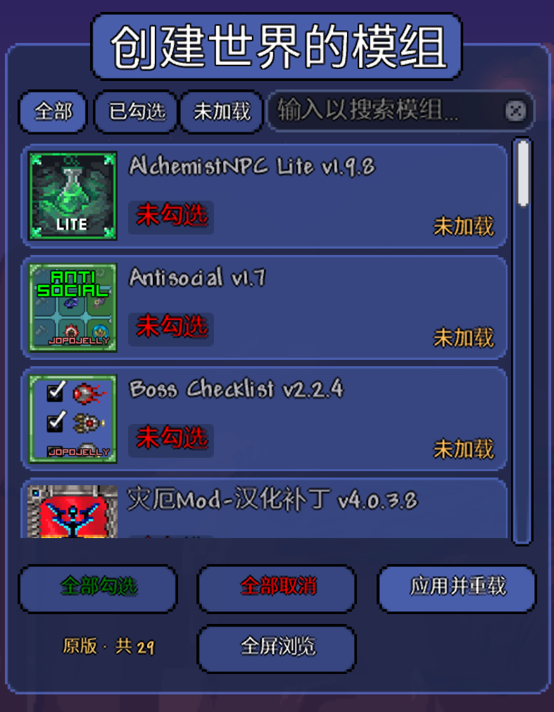

# Per-World Mods

*One world, one mod list.*

Per-World Mods is a client-side [tModLoader](https://github.com/tModLoader/tModLoader) mod that gives every Terraria world its own fixed mod list. The list lives inside the world file, so it travels with the save and never depends on a global "enabled mods" list you have to keep rebuilding by hand. Pick a world whose mods aren't loaded and the mod swaps in the right set in-process, then drops you back into the game — no restart.

> **中文**：Per-World Mods 是一个客户端 tModLoader 模组，给每个泰拉瑞亚世界固定一份模组清单。清单存在世界存档里，跟着存档走，不依赖那个需要你反复手动维护的全局「启用模组」列表。进入一个模组对不上的世界时，它会在进程内换成正确的模组集，然后把你送回游戏 —— 不用重启。



---

## Features

- **Per-world mod list** — the list lives in the world's header (`<world>.twld`), not in a global config. Copy the world to another machine and the list comes with it.
- **In-process mod reload** — switching a world's mod set reloads mods without closing the game, and returns you to the world-creation screen with seed, name, size, difficulty and world evil all preserved.
- **Three-way prompt when the loaded mods don't match** — *Switch & enter* / *Enter anyway* / *Cancel*. In multiplayer the switch option is hidden, since the server dictates the mod set.
- **Character-tagged worlds enter silently** — mark a character as the owner of a world and that world switches mods (if needed) and enters on a single click, with no prompt.
- **Dependency-aware selection** — ticking a mod auto-ticks the mods it requires (`modReferences`, recursively); unticking a mod auto-untick everything that depends on it. This mirrors tModLoader's own *Manage Mods* page.
- **Readable world list status** — one status per world, in priority order:

  | Status | Meaning | Available actions |
  | --- | --- | --- |
  | `Missing` | some mods in this world's list are not downloaded | browse & repair |
  | `Pending` | list changed, reload not applied yet | apply |
  | `Vanilla` | empty list, plays with no mods | edit |
  | `OK` | loaded mods match the list | play |

- **Compact + fullscreen mod picker** — search, filter (all / selected / not loaded), scroll, and an enlarge button. Fits next to the world-creation panel.
- **Built-in manual** — a *使用说明* button opens an in-game help page, so users never have to hunt for a README.

## Design rules

These are deliberate, and the mod will not break them:

- **Never auto-adds mods.** Only an explicit action changes a world's list.
- **Never hard-blocks world entry.** If mods are missing you can always choose to enter anyway (it may not be playable, but it is your call).
- **Mods must already be downloaded.** Turning a mod on never downloads anything.
- **Never silently changes the global enabled-mod list** — only in response to an explicit request, and the previous set is restored on demand.

## How it works (short version)

- The list is persisted in the world header via `ModSystem.SaveWorldHeader` (keys `LockedMods` / `LockedModsEmpty`).
- The effective list comes from, in priority order: a pending (not yet applied) list → world header → the world's native `usedMods`.
- Reloading is done in-process by calling into tModLoader's own `EnableMod` / `DisableMod` / `Reload` through reflection; if that ever fails the mod falls back to restarting the game. A handoff file + `AppDomain` data carries the "please auto-enter this world after the reload" request across the reload.
- The dependency graph is read from the `.tmod` metadata tModLoader has already parsed (`ModOrganizer.AllFoundMods` → `BuildProperties.RefNames(includeWeak: false)`), so no mod archive is unpacked twice and weak references are ignored, exactly like *Manage Mods*.

## Installation

1. Install [tModLoader](https://store.steampowered.com/app/1281930/tModLoader/) (this build targets the 2026.08 stable release).
2. Download `PerWorldMods.tmod` from [Releases](https://github.com/wellkaj/PerWorldMods/releases/latest).
3. Drop it into `Documents/My Games/Terraria/tModLoader/Mods/`, or use *Manage Mods → Open Mods Folder*.
4. Enable the mod and reload.

> **Note:** the in-game interface is currently in Chinese. Localisation contributions are welcome — everything lives in `Localization/`.

## Building from source

```bash
# tModLoader must be closed, otherwise the build fails with TML003
dotnet build -c Release
```

The project reads `TMLDir` (default `D:\steam\steamapps\common\tModLoader`) to find `tMLMod.targets`. On a different install, either edit that one line in `PerWorldMods.csproj` or pass it in:

```bash
dotnet build -c Release -p:TMLDir="C:\Program Files (x86)\Steam\steamapps\common\tModLoader"
```

The `.tmod` is written to `Documents/My Games/Terraria/tModLoader/Mods/PerWorldMods.tmod`.

Requirements: .NET 8 SDK and a local tModLoader installation.

## Repository layout

| Path | Contents |
| --- | --- |
| `src/WorldLockStore.cs` | header / pending / character persistence, effective-list resolution |
| `src/WorldLockSystem.cs` | `ModSystem` hooks (`SaveWorldHeader`, `PostSetupContent`, …) |
| `src/UI/ModPickerPanel.cs` | the mod picker (rows, filters, search, fullscreen layout) |
| `src/UI/HelpPanel.cs` | the in-game manual overlay |
| `src/UI/ModDeps.cs` | dependency table + recursive dependency / dependent queries |
| `src/UI/UiText.cs` | pixel-accurate wrapping and truncation (Terraria's `UIText` only wraps on spaces, which does nothing for Chinese text) |
| `src/UI/WorldPlayGate.cs` | entry prompt, auto-switch + auto-enter, cross-reload handoff |
| `src/UI/WorldModApplier.cs` | builds the final enabled set (dependency closure) and performs the reload |
| `src/UI/WorldCreationPanelHost.cs` | world-list status button, character note, creation-screen integration |
| `docs/` | cover art |

## Known limitations

- Switching mods requires a reload; the first frame after the reload is the world-creation screen, not your world. Auto-enter handles that for character-tagged worlds and for the *Switch & enter* path.
- The list is bound to the world file. Deleting the world deletes the list.
- Multiplayer worlds use the server's mod set; the mod only reads the list there.

## License

Not yet decided — until a `LICENSE` file is added, assume all rights reserved.
